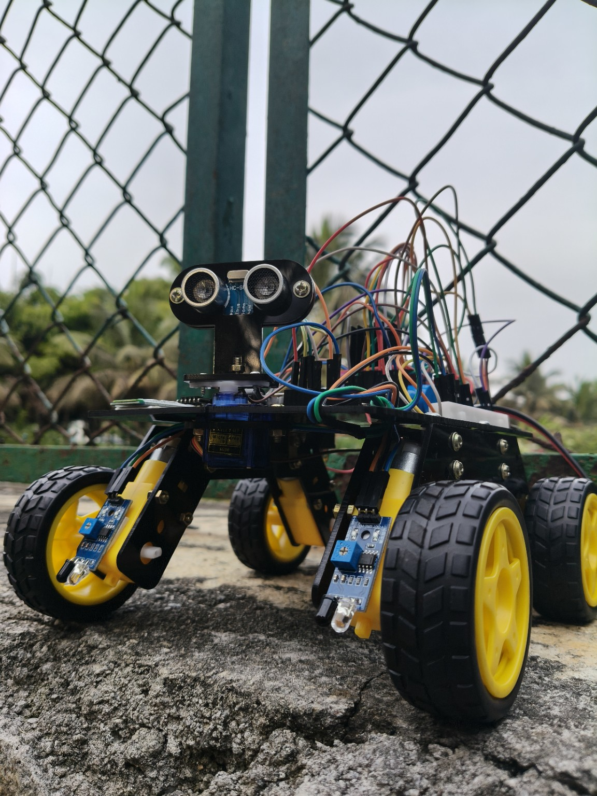
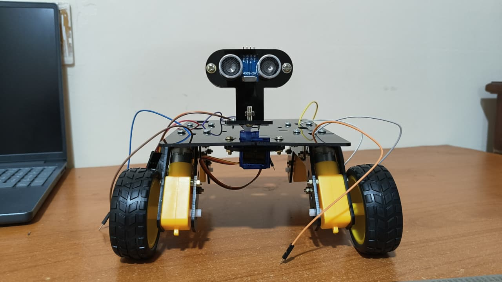

# Arduino Autonomous RC Car

A four-wheel multifunctional robotic car documented as an academic **All-in-One Robot** project. The recovered Arduino sketch describes Bluetooth-based manual driving and four sensor-based operating modes.

> **Reconstruction note:** This repository was assembled from the source file, photographs, demonstration video and short project report that remain available. The original prototype is no longer available for testing. The recovered sketch has not been independently compiled or tested as part of this repository reconstruction. It is preserved as recovered source, not represented as verified final firmware.

## Project at a glance

- Four-wheel mobile robot chassis with DC geared motors.
- Ultrasonic distance sensing mounted on a servo for directional scanning.
- Infrared sensing for line/object detection.
- Bluetooth serial control for manual driving and selecting modes.
- Recovered firmware written for an Arduino-style board; its pin definitions and `SoftwareSerial` usage indicate an **Arduino Uno-class setup**.

## Photographs and demonstration

### Outdoor prototype

### Front view

A short demonstration recording is included at [`videos/robot-demo.mp4`](videos/robot-demo.mp4).

## Modes described in the recovered sketch

| Bluetooth command | Mode | Behavior described by the code |
|---|---|---|
| `M` | Manual Bluetooth control | Reads movement commands from the Bluetooth serial connection. |
| `C` | Obstacle avoidance | Uses ultrasonic distance readings and a servo scan to choose a direction. |
| `1` | Line following | Uses the two bottom IR sensors to steer along a line. |
| `2` | Line following with obstacle avoidance | Combines bottom IR sensing with an ultrasonic distance check. |
| `3` | Object following | Uses the ultrasonic sensor and the two top IR sensor inputs. |

Manual movement commands in the recovered sketch are `F` (forward), `B` (backward), `L` (left), `R` (right) and `S` (stop).

These are features implemented in the **recovered sketch**. They should not be read as a claim that every mode has been retested recently.

## Hardware identified from available evidence

The photos show a four-wheel chassis, yellow DC geared motors, a front-mounted ultrasonic module on a servo, and infrared sensor boards. The sketch additionally defines a Bluetooth serial interface and separate left/right motor direction and enable pins.

| Component / subsystem | Evidence and notes |
|---|---|
| Four-wheel chassis and DC geared motors | Visible in both prototype photographs. |
| Ultrasonic distance sensor | Visible in photographs; sketch uses the `NewPing` library. |
| Servo motor | Visible beneath the ultrasonic sensor; sketch uses `Servo.h`. |
| Infrared sensors | Visible on the chassis; sketch defines two bottom and two top sensor inputs. |
| Bluetooth module | Specified by the sketch as an HC-05-style serial link using `SoftwareSerial`. Exact module revision is not confirmed by the photos. |
| Motor driver | Required by the sketch's enable/direction outputs and mentioned in the project report. Exact fitted driver board is not confirmed. |
| Controller | The recovered code uses Uno-style pin names and `SoftwareSerial`; this is consistent with an Arduino Uno-class board. A clear photo of the controller board is not available. |

## Pin assignments in the recovered sketch

| Function | Pin |
|---|---:|
| Servo signal | D3 |
| Ultrasonic trigger | D11 |
| Ultrasonic echo | D12 |
| Bottom-right IR | A0 |
| Bottom-left IR | A1 |
| Top-left IR | A2 |
| Top-right IR | A3 |
| Right motor enable | D5 |
| Right motor direction | D7, D8 |
| Left motor enable | D6 |
| Left motor direction | D9, D10 |
| Bluetooth receive (Arduino RX) | D2 |
| Bluetooth transmit (Arduino TX) | D4 |

These are **code-defined pin assignments**, not a verified wiring diagram. Check the actual circuit before reusing them on hardware.

## Source code and dependencies

The recovered sketch is stored at [`src/RC_CAR_recovered.ino`](src/RC_CAR_recovered.ino). Its includes are:

- `Servo.h`
- `NewPing.h`
- `SoftwareSerial.h`

The source file was preserved without silently rewriting its behavior. It should be reviewed before attempting to compile or run it. In particular, the autonomous routines use blocking delays, and their Bluetooth override handling is limited; mode changes other than the manual override may not be handled as a user might expect while an autonomous mode is running.

## Project report context

The available three-page report names the academic project **All-in-one robot** for **Basic Mechanical Engineering (ME135)**. It describes the broad concept of combining sensors, processing, actuators and Bluetooth control. The report lists IR obstacle sensing, a Bluetooth module, motor driver, ultrasonic distance sensor, an SMD board and a servo motor. A cleaned summary is provided in [`docs/project-report-summary.md`](docs/project-report-summary.md).

## Known limitations

- The original physical prototype is no longer available to the author for further testing.
- The recovered sketch has not been independently compiled or tested during this repository reconstruction.
- The precise motor-driver model, controller-board revision, complete wiring, power arrangement and app name are not confirmed by the available source materials.
- The report contains broad descriptions of possible robot applications; those are not evidence that all such applications were implemented in this prototype.

## Possible future work

- Recover another copy of the final sketch or original wiring diagram, if available.
- Confirm the exact controller and motor-driver boards from additional photos.
- Refactor Bluetooth handling so commands and mode changes are processed consistently in every mode.
- Replace long blocking delays with non-blocking timing where appropriate.
- Re-test each mode on compatible hardware and add a verified wiring diagram and bill of materials.

## Credits

This was originally documented as a team academic project. Team member names and student identifiers from the original report are intentionally omitted from this public repository copy.
